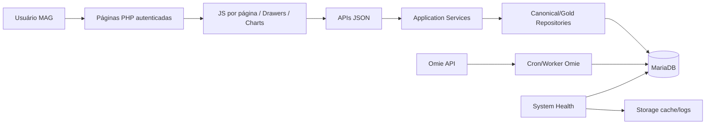

# BIomie — Mapa C4 simplificado

## Contexto
BIomie é o cockpit comercial da MAG. Ele consome dados do Omie por sync/cron, transforma em camadas canônicas e marts, e entrega dashboards, mapas, vendedores, produtos, metas e saúde do sistema.

## Containers

## Componentes principais
- `PageRenderer` e `PageAssetRegistry`: shell visual e assets versionados.
- `api/*`: contratos JSON com source, diagnostics e empty states.
- `Modules/Sales/Application`: regras de leitura por domínio.
- `DataPlatform/Gold/Builders`: materialização dos marts.
- `SystemHealth/Checks`: observabilidade operacional.

## Restrições arquiteturais
- GET de página não chama Omie.
- GET de página não materializa Gold.
- JS não resolve regra de negócio; ele renderiza payload já normalizado.
- Banco local é a fonte de verdade operacional da tela.
